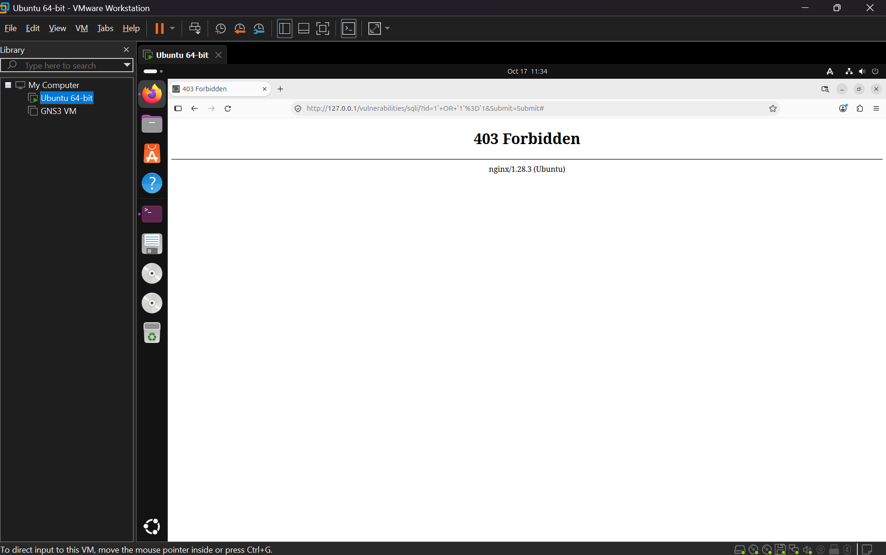
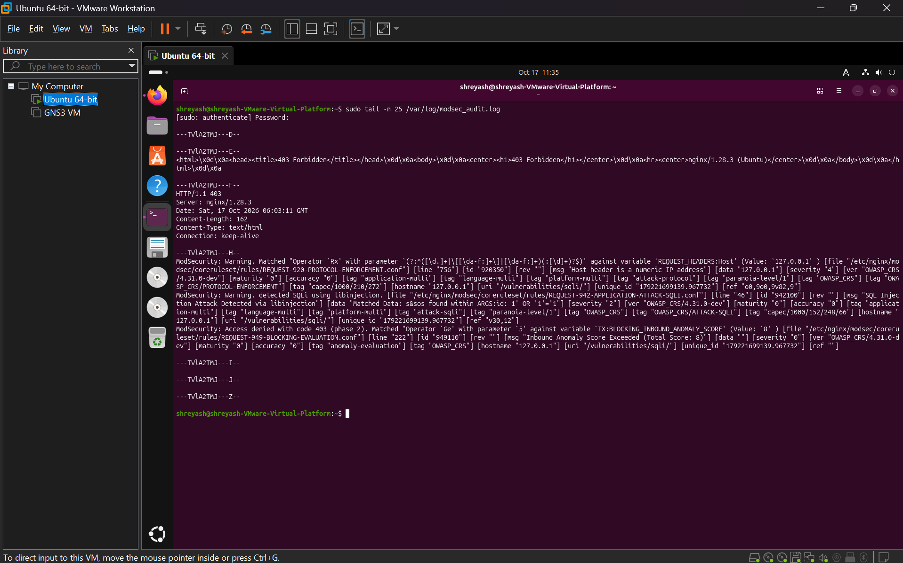

# Web Application Firewall (WAF) & Defensive Reverse Proxy Lab

An isolated cybersecurity home lab demonstrating web application vulnerability mitigation using an **Nginx Reverse Proxy** integrated with **ModSecurity v3** and the **OWASP Core Rule Set (CRS)** in front of a containerized vulnerable target (**DVWA**).

---
## 🏗️ Architecture Overview

Traffic flows from the client to the Nginx reverse proxy where ModSecurity inspects HTTP request payloads at Layer 7 before routing clean requests to the backend application:

```text
[ Client / Attacker ]
         │ (HTTP Requests on Port 80)
         ▼
┌────────────────────────────────────────────────────────┐
│ Nginx Reverse Proxy + ModSecurity v3 WAF               │
│ - Inspects URI, Headers, and Body                      │
│ - OWASP Core Rule Set (CRS) Detection Engine           │
│                                                        │
│  [ Malicious Payload ] ──> HTTP 403 Forbidden (Drop)   │
│  [ Clean Request ]     ──> Proxy Pass to Port 8080     │
└────────────────────────────────────────────────────────┘
                         │
                         ▼
┌────────────────────────────────────────────────────────┐
│ Docker Container (127.0.0.1:8080)                      │
│ - Damn Vulnerable Web Application (DVWA)               │
└────────────────────────────────────────────────────────┘
```

---

## 🛠️ Technologies Used

* **Target Application:** Damn Vulnerable Web Application (DVWA) running via Docker
* **Reverse Proxy:** Nginx (v1.28)
* **Firewall Engine:** ModSecurity v3 (`libnginx-mod-http-modsecurity`)
* **Rule Definitions:** OWASP Core Rule Set (CRS v4)
* **Environment:** Ubuntu Linux on VMware Workstation

---

## 🧪 Testing & Verification

### 1. Detection Mode (`DetectionOnly`)
* **Objective:** Verify WAF visibility into incoming payloads without disrupting traffic.
* **Execution:** Submitted a simulated SQL Injection payload (`1' OR '1'='1`) into the User ID field.
* **Finding:** The application rendered user profiles while ModSecurity generated warning logs identifying the attack signature via `libinjection`.

### 2. Active Prevention Mode (`SecRuleEngine On`)
* **Objective:** Actively terminate malicious transactions before reaching the backend application.
* **Execution:** Re-submitted the SQL Injection string `1' OR '1'='1`.
* **Result:** The transaction was immediately aborted at the proxy tier, returning an **HTTP 403 Forbidden** error.



---

## 📊 Blue Team Log Analysis

Inspection of `/var/log/modsec_audit.log` confirmed rule triggering and cumulative anomaly calculation:

* **Rule Triggered:** `REQUEST-942-APPLICATION-ATTACK-SQLI.conf` (Rule ID: `942100`)
* **Detection Mechanism:** SQLi identified via `libinjection` regex matching `s&sos` in `ARGS:id`.
* **Anomaly Scoring:**
  * Protocol warning (Numeric IP Host): **+3 points**
  * Critical Attack (SQL Injection): **+5 points**
  * **Total Inbound Anomaly Score:** **8** (Threshold: 5)
* **Action:** `ModSecurity: Access denied with code 403 (phase 2)`.



---

## 🛡️ False Positive Validation

To ensure usability was maintained alongside security:
* Submitted valid integer inputs (`1`).
* ModSecurity assigned an Anomaly Score of **0**.
* Nginx successfully proxied the request to DVWA, returning expected records with an **HTTP 200 OK** response.

---

## 🚀 Key Takeaways

1. **Defense-in-Depth:** WAF provides critical perimeter protection (virtual patching), but code-level remediation (Parameterized Queries/Prepared Statements) remains mandatory for root-cause security.
2. **Layer 7 Visibility:** Traditional Layer 3/4 firewalls allow HTTP/80 blindly; Layer 7 inspection is necessary to detect payload-level exploits.
3. **Anomaly Scoring Benefits:** Cumulative scoring mitigates false positives by evaluating the aggregate risk of a request rather than blocking on single low-severity triggers.
